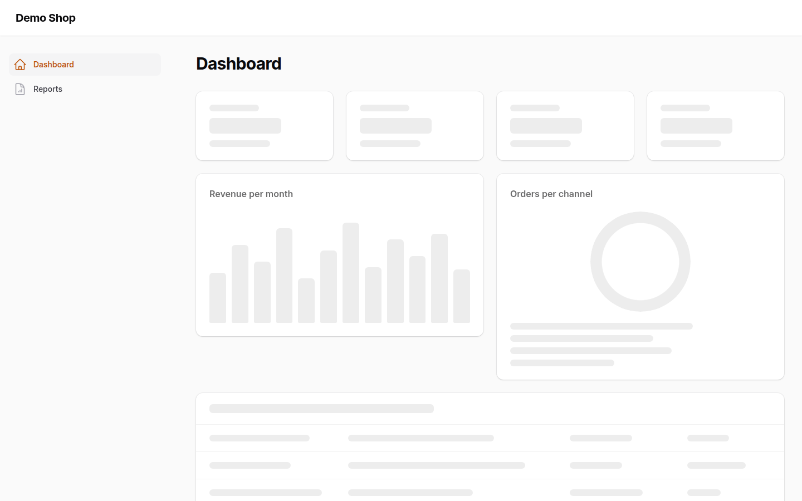
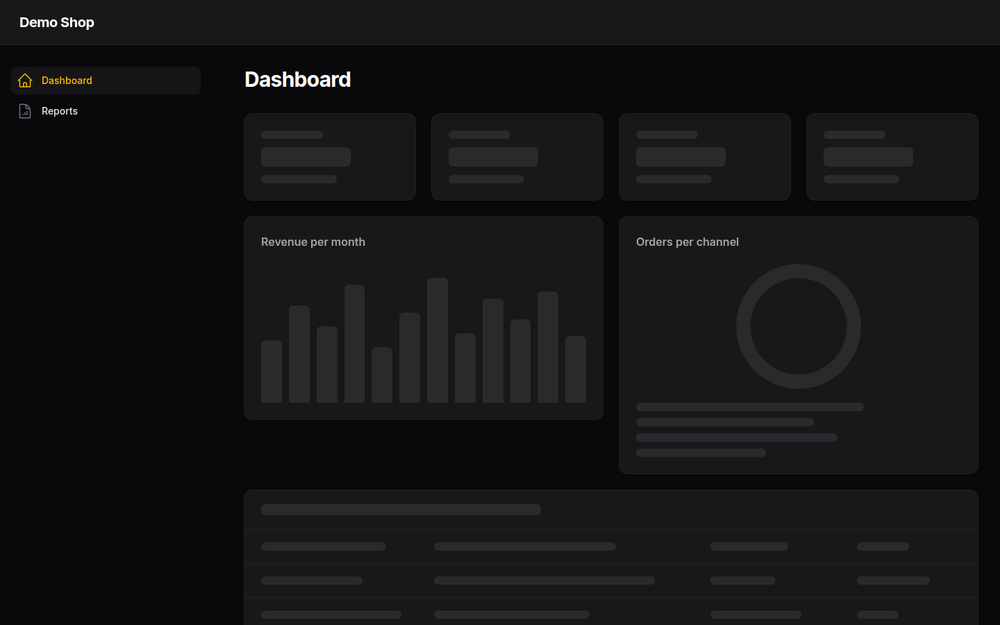
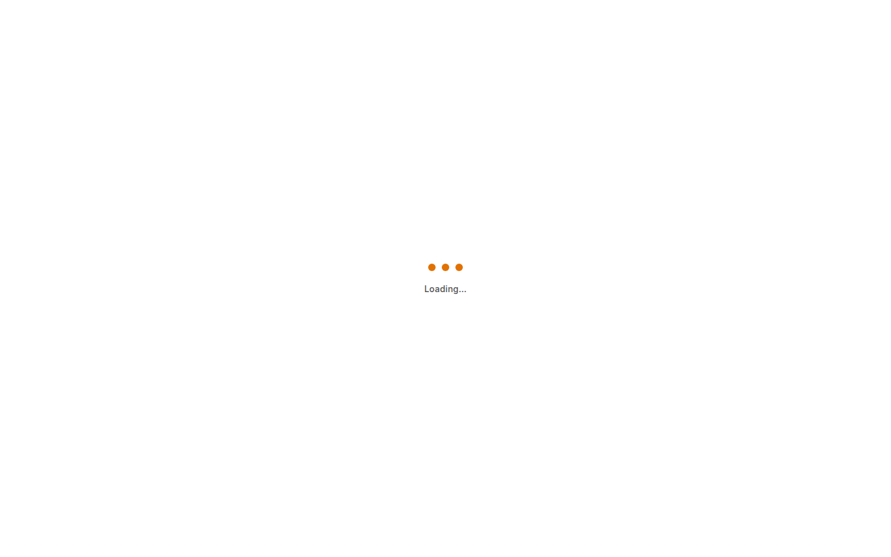

# Filament Skeleton Loading

[](https://packagist.org/packages/mortalkiller/filament-skeleton-loading)
[](https://packagist.org/packages/mortalkiller/filament-skeleton-loading)
[](https://github.com/mortalkiller/filament-skeleton-loading/actions/workflows/tests.yml)
[](LICENSE.md)

[](https://plumbphp.dev/mortalkiller/filament-skeleton-loading)
[](https://plumbphp.dev/mortalkiller/filament-skeleton-loading)
[](https://plumbphp.dev/mortalkiller/filament-skeleton-loading)
[](https://plumbphp.dev/mortalkiller/filament-skeleton-loading)
[](https://plumbphp.dev/mortalkiller/filament-skeleton-loading)

Skeleton loading states for **Filament 4 and 5** panels. Lazy widgets, lazy sections and deferred tables show the shape of what is coming (stat tiles, a chart, table rows) instead of a grey box or a spinner.

Plain CSS and Blade, no theme build, no new loading behaviour: the package only changes what Filament draws while it waits.

## Why

Filament already loads widgets lazily and can defer tables, but while they load it shows an empty pulsing box or a spinner. The page then jumps when the real content arrives, and nothing tells the user what is about to appear. Fixing that per widget means overriding `placeholder()` and writing skeleton markup and CSS in every application.

This package keeps Filament's own loading mechanisms (`placeholder()`, `deferLoading()`, the `loading-section` view) and only changes what is drawn while waiting. It does not add polling, new Livewire requests or JavaScript to the loading itself.

Non-goals: skeletons for forms, infolists or modals, and skeletons while a table filters or paginates (Filament dims the table in place, which reads better than swapping it for a skeleton).

## Documentation

Full documentation, guides and API reference:

**https://docs.pedromonteiro.dev/filament-skeleton-loading/**

- [Installation](https://docs.pedromonteiro.dev/filament-skeleton-loading/getting-started/installation/)
- [Widgets and tables](https://docs.pedromonteiro.dev/filament-skeleton-loading/guides/widgets-and-tables/)
- [Page loader](https://docs.pedromonteiro.dev/filament-skeleton-loading/guides/page-loader/)
- [Configuration](https://docs.pedromonteiro.dev/filament-skeleton-loading/guides/configuration/)
- [API reference](https://docs.pedromonteiro.dev/filament-skeleton-loading/api/)

## Contents

- [Why](#why)
- [Documentation](#documentation)
- [Features](#features)
- [Screenshots](#screenshots)
- [Version compatibility](#version-compatibility)
- [Installation](#installation)
- [Usage](#usage)
- [Page loader](#page-loader)
- [Configuration](#configuration)
- [Accessibility](#accessibility)
- [Testing and contributing](#testing-and-contributing)
- [Changelog](#changelog)
- [Roadmap](#roadmap)
- [Security](#security)
- [Support this project](#support-this-project)
- [Credits and license](#credits-and-license)

## Features

- **Typed widget skeletons** with the `HasSkeletonPlaceholder` trait, detected from the widget class:
  - stats overview: one tile per column;
  - chart: bars, a line or a ring (doughnut, pie, polar area), with the chart's real heading;
  - table widget: header and rows.
- **Relation managers** with the same trait get a table skeleton.
- **Generic skeleton** for every other lazy widget, relation manager or Livewire component, with no code change.
- **Deferred tables** draw skeleton rows instead of Filament's spinner.
- **Database notifications** panel: three placeholder notifications instead of a spinner.
- **Lazy loaded schemas** (`Section::make()->schema(...)->lazyLoaded()`): form rows (label and field) instead of a spinner.
- **Page loader** (opt-in): a full-screen loader between pages with your brand symbol, shown only when the next page is slow.
- **Shimmer** that can be turned off, and that always stands still for `prefers-reduced-motion`.
- Light and dark mode; translations for `en`, `pt`, `pt_PT` and `pt_BR`.

## Screenshots

| Light | Dark |
| --- | --- |
|  |  |

The page loader with the default symbol:



The screenshots come from the Workbench demo panel. Run it locally with `composer browser:prepare && composer serve` and open `/admin`.

## Version compatibility

| Package | PHP | Laravel | Filament |
| --- | --- | --- | --- |
| 1.x | 8.3, 8.4, 8.5 | 12, 13 | 4.12.6+ and 5.8.1+ |

CI tests the lowest and latest dependency sets of each Filament major.

## Installation

```bash
composer require mortalkiller/filament-skeleton-loading
```

Register the plugin on the panel:

```php
use MortalKiller\FilamentSkeletonLoading\SkeletonLoadingPlugin;

$panel->plugin(SkeletonLoadingPlugin::make());
```

The stylesheet is published with Filament's assets (`php artisan filament:assets`, which `filament:upgrade` already runs after `composer install`).

## Usage

### Widgets

Add the trait to a lazy widget or relation manager (both are lazy by default):

```php
use Filament\Widgets\ChartWidget;
use MortalKiller\FilamentSkeletonLoading\Concerns\HasSkeletonPlaceholder;

class RevenueChart extends ChartWidget
{
    use HasSkeletonPlaceholder;

    // ...
}
```

Fine-tune with properties:

```php
protected ?int $skeletonItems = 3; // stat tiles (stats widgets)
protected ?int $skeletonRows = 8;  // rows (table widgets and relation managers)
```

Widgets without the trait still get the generic skeleton.

### Tables

Use Filament's own deferred loading on a table:

```php
return $table
    ->deferLoading()
    ->columns([/* ... */]);
```

or defer every table of the panel from the plugin (a closure decides per table):

```php
use Filament\Resources\Pages\ListRecords;
use Filament\Tables\Table;

SkeletonLoadingPlugin::make()
    ->deferTables(fn (Table $table): bool => $table->getLivewire() instanceof ListRecords);
```

## Page loader

Off by default. When on, leaving for another page of the panel (a link or a plain form) shows a full-screen loader, but only if the next page takes longer than the delay, so fast pages never flash. Livewire requests (actions, filters, polling) and downloads never show it, and it hides itself after 10 seconds.

```php
SkeletonLoadingPlugin::make()
    ->pageLoader()                                           // ->pageLoader(false) turns it off
    ->pageLoaderSymbol(fn () => view('brand.loader-symbol')) // optional; three dots otherwise
    ->pageLoaderDelay(300)                                   // milliseconds before it shows
    ->pageLoaderLabel('Loading…');                           // optional; translated "Loading…" otherwise
```

The symbol is any markup (a string, an `Htmlable`, a view or a closure returning one). It is rendered as trusted HTML, so pass your own markup, never user input. Give the elements that should come in one after the other the class `fsl-loader-piece` (up to six, animated in document order); they take the panel's primary colour, white in dark mode:

```blade
<svg viewBox="0 0 120 96" width="64" height="52" fill="currentColor">
    <rect class="fsl-loader-piece" x="0" y="0" width="120" height="20" rx="10"/>
    <rect class="fsl-loader-piece" x="0" y="38" width="88" height="20" rx="10"/>
</svg>
```

## Configuration

Global settings, in `.env` (or publish the config with `php artisan vendor:publish --tag=filament-skeleton-loading-config`):

| Setting | Env | Default | Effect |
| --- | --- | --- | --- |
| `enabled` | `SKELETON_LOADING_ENABLED` | `true` | Off: Filament's own grey placeholder and spinner everywhere, the trait included, and no page loader. |
| `defer_tables` | `SKELETON_LOADING_DEFER_TABLES` | `false` | Every table of the panels using the plugin loads after the page, with skeleton rows. |

Plugin methods, per panel:

| Method | Default | Effect |
| --- | --- | --- |
| `shimmer(bool $condition = true)` | on | Light sweeping across the skeleton. |
| `pageLoader(bool $condition = true)` | off | Full-screen loader between pages (see [Page loader](#page-loader)). |
| `pageLoaderSymbol(string\|Htmlable\|Closure $symbol)` | three dots | Brand symbol of the page loader. |
| `pageLoaderDelay(int $milliseconds)` | `300` | How long a page may take before the loader shows. |
| `pageLoaderLabel(string\|Closure $label)` | "Loading…" (en, pt, pt_PT, pt_BR) | Text under the symbol, also read by screen readers. |
| `deferTables(bool\|Closure $condition = true)` | the `defer_tables` setting | Calls `deferLoading()` on the panel's tables; a closure decides per table. |

## Accessibility

Every skeleton is a `role="status"` region with `aria-busy="true"` and Filament's translated "Loading" label for screen readers; the shapes themselves are `aria-hidden`. Animations stop for users who prefer reduced motion.

## Testing and contributing

In your application's Livewire tests, load a deferred table before asserting on its records:

```php
Livewire::test(ListOrders::class)->loadTable()->assertCanSeeTableRecords($orders);
```

Turning `defer_tables` on in an app with Livewire table tests means calling `->loadTable()` in those tests; pin the setting in `phpunit.xml` to keep tests independent of `.env`.

To work on the package itself:

```bash
composer install
composer check            # Pint, Larastan and Pest
npm install
npm run test:browser      # Playwright against the Workbench panel
```

See [CONTRIBUTING.md](CONTRIBUTING.md) for the development flow.

## Changelog

Release notes are published with each [GitHub Release](https://github.com/mortalkiller/filament-skeleton-loading/releases).

## Roadmap

See [docs/roadmap.md](docs/roadmap.md).

## Security

Report vulnerabilities privately using [SECURITY.md](SECURITY.md).

## Support this project

If this package saves you time, consider supporting its development:

https://buymeacoffee.com/mortalkiller

## Credits and license

- [Pedro Monteiro](https://pedromonteiro.dev)

MIT. See [LICENSE.md](LICENSE.md).
